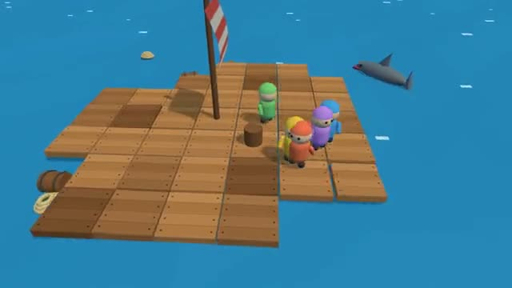

# Raft Drift

Hook what floats by. Grow the raft. Mind the shark. A multiplayer starter game from [Multiplayer Agent](https://multiplayeragent.com): 3D, co-op, 1–6 players, with bot sailors that help when you play alone.

## How it plays

Throw your hook at planks, barrels and crates drifting past to fill the crew's stash, then spend it on new raft tiles. A shark circles and bites the edge tiles: hook it a few times to chase it off, and stay out of the water.

**Controls:** WASD to walk, click the sea to throw your hook, B to build, or a thumb stick, tap to throw and the BUILD button.

## Make it yours in the Game Builder

Open the [Game Builder](https://multiplayeragent.com), choose **Start from a starter game** and pick Raft Drift. It opens as version 1 in your studio, ready to play and publish. Then ask for changes, for example:

- Add a fishing rod that catches fish to cook
- Add a storm every few minutes with bigger waves
- Let players build a sail that steers the raft

## Run it yourself

1. Get a free publishable key (`pk_…`) at [multiplayeragent.com](https://multiplayeragent.com).
2. In `index.html`, put it in place of `pk_REPLACE_ME` in the `MP_CONNECT` block.
3. Serve the folder (for example `npx serve`) and open it. The 3D engine loads as a module, which browsers block from a file on disk.

Without a key it still runs, offline with bots, and remembers your raft in this browser.

## How it is built

- One `index.html` plus three.js in `libs/`. The comment at the top of the script maps the code and explains the multiplayer.
- **World memory:** The raft is remembered by its crew. Every player saves a copy every 10 seconds and when they leave; whoever comes back first brings back every tile and the crew's stash, and a copy with more building in it replaces a newer, smaller one.
- **Host-run rules:** The host's browser drifts the debris, runs the shark and checks every tile built. If it leaves, the next player takes over.
- **Leaderboard:** The biggest raft, in tiles, each player has sailed on.
- **Bots:** Bot sailors hook debris, build tiles and smack the shark until enough people join.
- **Live sync:** Every sailor, hook, tile and shark bite shows up for everyone at once.
- `?attract` runs it offline with bots only. The preview video is recorded from it.

## License

MIT. three.js in `libs/` is MIT too (Copyright 2010-2024 three.js authors).
